# Island Desktop

**A Dynamic Island, a floating dock, phone media and a living island for your desktop.**

The Windows edition brings the top bar, dock and media controls together in Cortiva Ink. Add AirPlay to play music and supported YouTube video from your iPhone or iPad, or Fairy Lagoon V7 for three little companions with their own places to work and relax. The original GNOME edition includes a coordinated Ubuntu desktop appearance.

[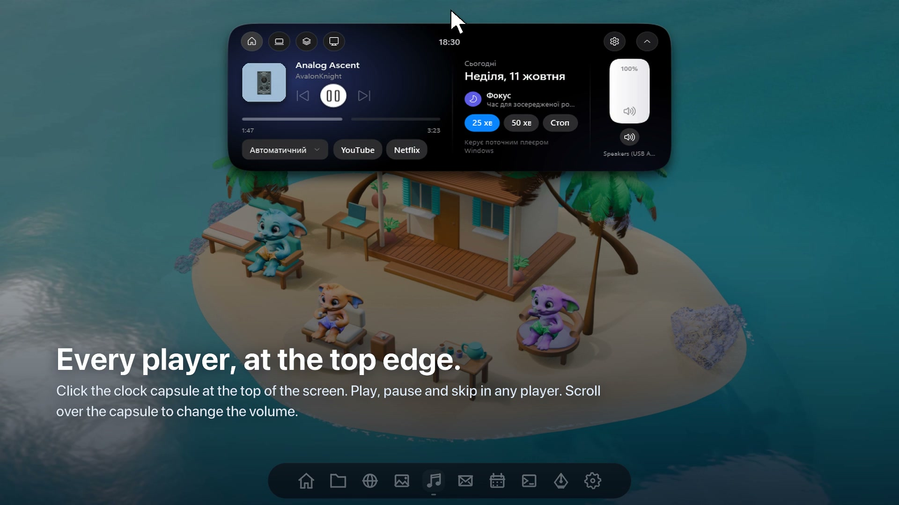](https://github.com/endrymagolas-wq/island-desktop/releases/download/windows-v0.4.0-beta.2/island-desktop.mp4)

*41 seconds, 1080p, with music. Every scene shows what to click and what happens. The panels are the real Windows application; the lagoon is the shipped V7 render.*

[Watch the video](https://github.com/endrymagolas-wq/island-desktop/releases/download/windows-v0.4.0-beta.2/island-desktop.mp4) · [Downloads](https://github.com/endrymagolas-wq/island-desktop/releases/tag/windows-v0.4.0-beta.2) · [Windows quick start, українською](docs/WINDOWS_RELEASE.md) · [GNOME guide](docs/DESKTOP.md)

## Downloads

Take everything in one download, or only the parts you want. Every Windows package is portable: extract it and start the file named below. Nothing is installed system-wide. All packages are in release **[windows-v0.4.0-beta.2](https://github.com/endrymagolas-wq/island-desktop/releases/tag/windows-v0.4.0-beta.2)**; unchanged components are served from beta 1.

### Full Windows desktop

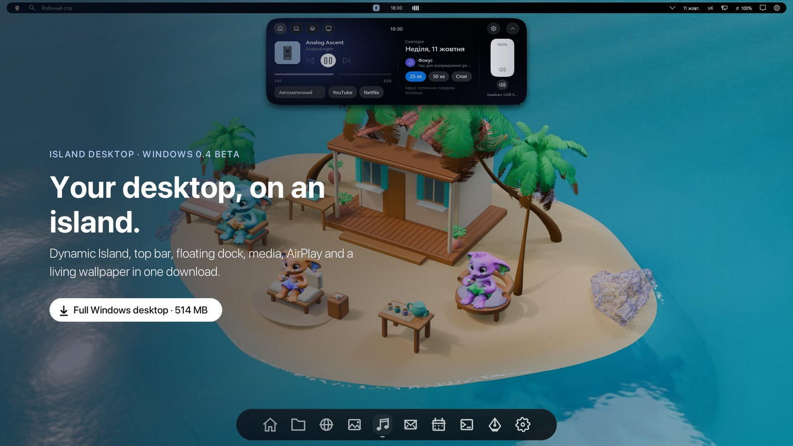

Island, top bar, dock, media controls, AirPlay receiver and the Fairy Lagoon V7 wallpaper, set up to work together. .NET and Python are included; the wallpaper needs [Lively Wallpaper](https://www.rocksdanister.com/lively/).

**[Download Full Windows desktop · 514 MB](https://github.com/endrymagolas-wq/island-desktop/releases/download/windows-v0.4.0-beta.2/island-desktop-windows-full-0.4.0-beta.2.zip)** · start `IslandDesktop-Windows-Full/Start-Desktop.cmd`

### Windows island

The core application: island, top bar, dock, media, focus timer and app volume. .NET is included. No wallpaper and no AirPlay receiver.

**[Download Windows island · 88 MB](https://github.com/endrymagolas-wq/island-desktop/releases/download/windows-v0.4.0-beta.2/island-desktop-windows-0.4.0-beta.2.zip)** · start `IslandDesktop-Windows/IslandDesktop.exe`

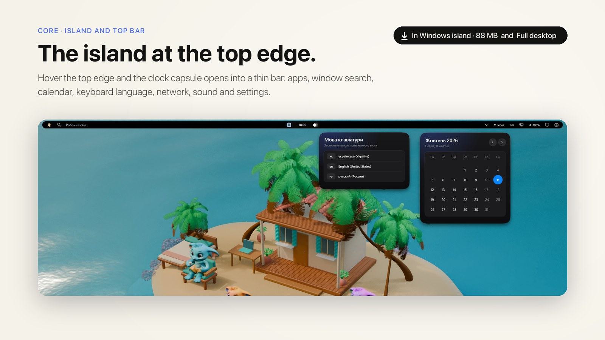

**Island and top bar.** Hover the top edge for a moment and the clock capsule opens into a thin bar. From there you reach your apps, a search over open windows, the calendar, keyboard language, network, sound and settings. Escape or a click outside closes it.

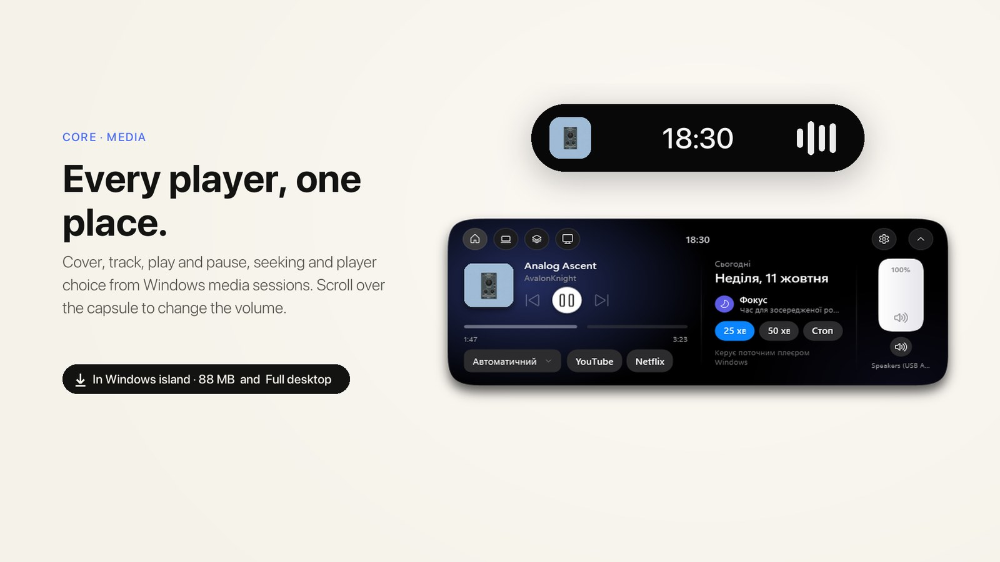

**Media.** Click the capsule for the media panel: cover, track, play and pause, seeking and the choice of player. It reads Windows media sessions, so it works with browsers, Spotify and other players that publish one. Scroll over the capsule to change the volume by 5 %.

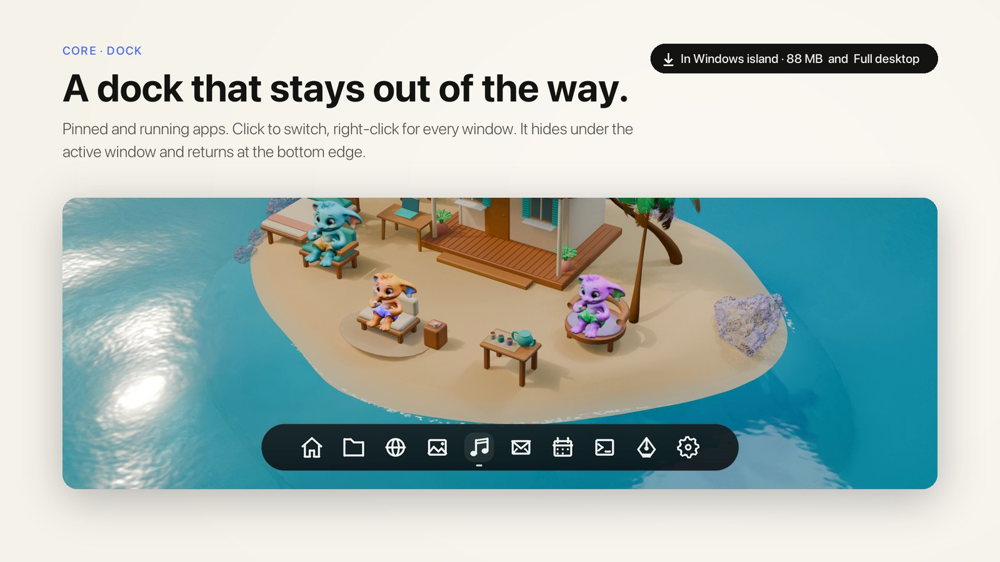

**Dock.** Pinned and running apps with their real icons. Click to launch or switch, right-click to see every window of that app. The dock hides when a window covers it; move the pointer to the bottom edge to bring it back.

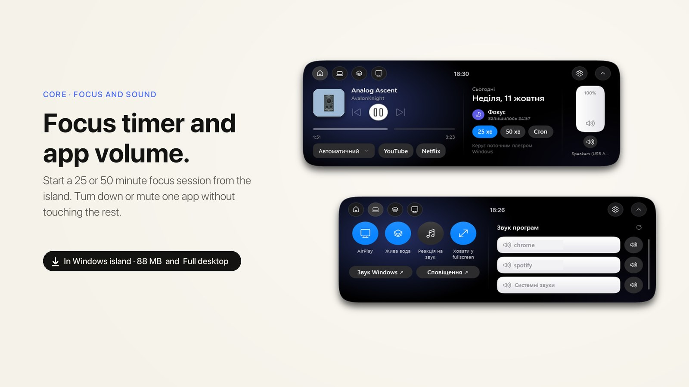

**Focus and sound.** Start a 25 or 50 minute focus timer from the media panel; it survives a restart. In the System page each app has its own volume and mute. The capsule can optionally react to what the PC is actually playing.

### AirPlay receiver

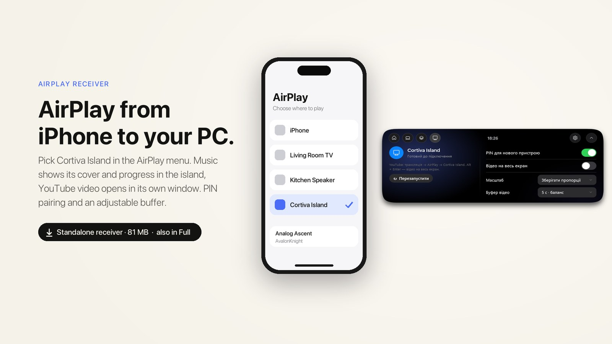

Your PC appears as **Cortiva Island** in the AirPlay menu of an iPhone or iPad on the same network. Music plays through the PC and the island shows its cover and progress. In YouTube, choose the cast button, then AirPlay, then Cortiva Island: the video opens in its own window, Alt + Enter for full screen. A new phone pairs once with a PIN shown in large digits in the island. The buffer can be set to 2, 5 or 8 seconds.

**[Download AirPlay receiver · 81 MB](https://github.com/endrymagolas-wq/island-desktop/releases/download/windows-v0.4.0-beta.1/cortiva-airplay-windows-0.4.0-beta.1.zip)** · start `Cortiva-AirPlay-Windows/Start-AirPlay.cmd` · also part of the Full desktop · [firewall steps](docs/AIRPLAY_WINDOWS.md)

### Fairy Lagoon V7 wallpaper

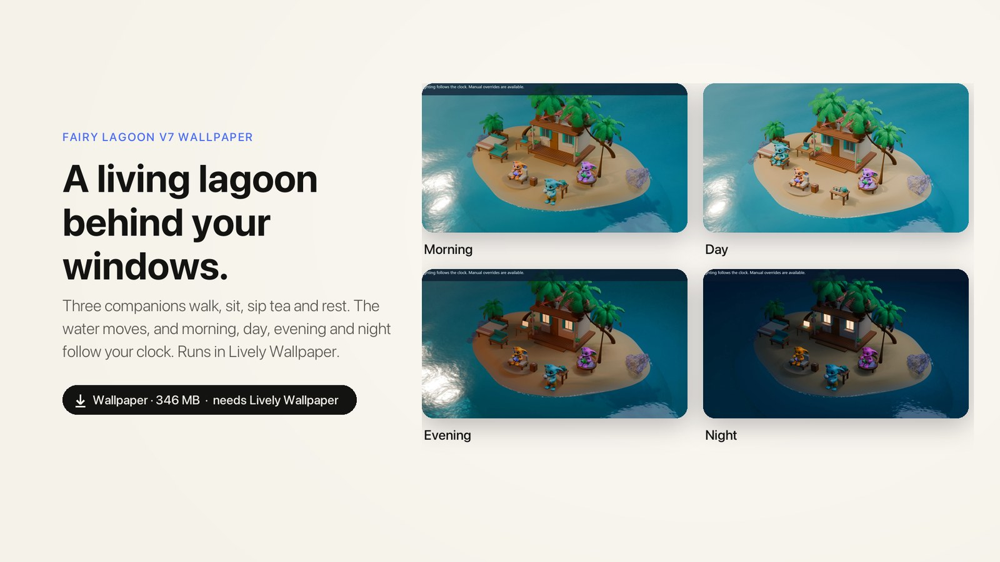

A larger island with three companions. They walk, sit, sip tea, lie on the daybed and brew tea. The water moves, and morning, day, evening and night follow the PC clock. Pre-rendered color and depth animation with 12-second water loops, played by a small local host inside Lively Wallpaper. Blender is not needed to run it.

**[Download Fairy Lagoon V7 · 346 MB](https://github.com/endrymagolas-wq/island-desktop/releases/download/windows-v0.4.0-beta.1/fairy-lagoon-v7-wallpaper-windows.zip)** · start `FairyLagoon-V7-Windows/Start-Wallpaper.cmd` · needs Lively Wallpaper · [V7 details](docs/WALLPAPER_V7.md)

### Blender source

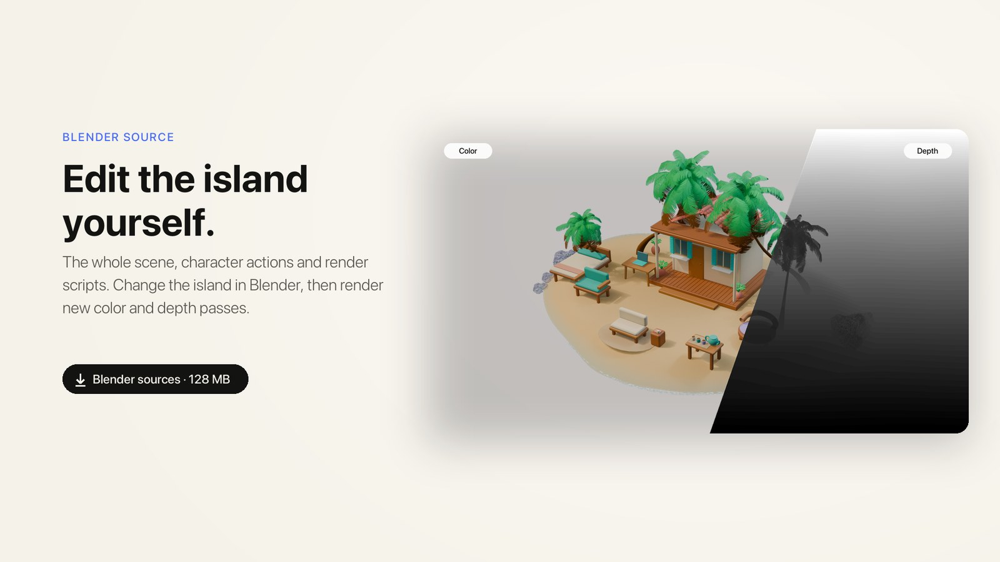

The editable scene, character actions and the build and render scripts behind the wallpaper. Change the island, then render new color and depth passes.

**[Download Blender sources · 128 MB](https://github.com/endrymagolas-wq/island-desktop/releases/download/windows-v0.4.0-beta.1/fairy-lagoon-v7-blender-sources.zip)** · open the `.blend` files in Blender

### GNOME edition

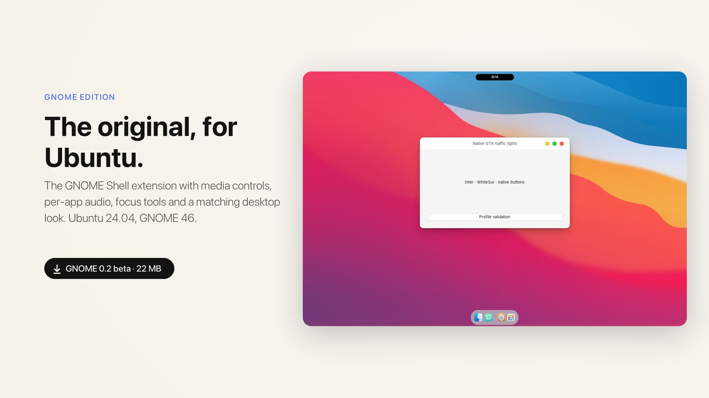

The original GNOME Shell extension: MPRIS media controls, per-app audio, focus tools, notification history and an optional coordinated desktop look. Ubuntu 24.04 with GNOME 46 on Wayland.

**[Download GNOME 0.2 beta · 22 MB](https://github.com/endrymagolas-wq/island-desktop/releases/download/v0.2.0-beta.1/gnome-dynamic-island-0.2.0-beta.1.zip)** · then `python3 install.py install --dry-run` and `python3 install.py install` · [GNOME guide](docs/DESKTOP.md)

### Also in the releases

| Download | What it is |
| --- | --- |
| [Small app update](https://github.com/endrymagolas-wq/island-desktop/releases/download/windows-v0.4.0-beta.2/island-desktop-windows-app-update-0.4.0-beta.2.zip) | Already using beta 1? This replaces only the application and its package metadata. Close the island and follow the included `DOCK_UPDATE.md`; keep your receiver, wallpaper and runtimes. |
| [Native dependency source](https://github.com/endrymagolas-wq/island-desktop/releases/download/windows-v0.4.0-beta.1/cortiva-airplay-native-corresponding-sources-0.4.0-beta.1.zip) | Exact corresponding sources and recipes for the shipped native receiver libraries, separate from the runtime bundle. |
| [Project source archive](https://github.com/endrymagolas-wq/island-desktop/archive/refs/tags/windows-v0.4.0-beta.2.zip) | Windows and GNOME code, installers and production scripts. UxPlay source and local changes ship with the receiver. [Checksums](https://github.com/endrymagolas-wq/island-desktop/releases/download/windows-v0.4.0-beta.2/SHA256SUMS). |
| [Feature images](https://github.com/endrymagolas-wq/island-desktop/releases/download/windows-v0.4.0-beta.2/island-desktop-images.zip) | The nine images above at 1920×1080 PNG. |

**Lively Wallpaper is an external dependency** for the wallpaper and full bundle. The core island and standalone receiver do not need it. Keep every extracted package's subfolders together. See [Windows installation](docs/INSTALL_WINDOWS.md), [AirPlay](docs/AIRPLAY_WINDOWS.md) and [V7](docs/WALLPAPER_V7.md) for setup and removal.

| Platform | Support boundary |
| --- | --- |
| **Windows** | Native x64 beta; tested on Windows 11 Pro x64, build 26200. Windows 10, ARM64 and every DPI/monitor arrangement are not validated. The interface is in Ukrainian. |
| **Linux** | Ubuntu 24.04 / GNOME Shell 46 / Wayland; tested on Ubuntu 24.04.5. This installer supports GNOME 46 only. KDE and Hyprland are unsupported. |

## Phone music and video

For the full Windows bundle, enable the receiver in **System → AirPlay**. The standalone receiver shows its PIN in its console. Put the phone and PC on the same LAN and choose **Cortiva Island**:

- **Music:** select it in the player's AirPlay output menu.
- **YouTube video:** cast button → **AirPlay / Bluetooth devices** → **Cortiva Island**. The supported direct-video path opens a PC video window.

A real iPhone was used to confirm audible music, audio after PIN pairing and moving YouTube video with sound. Artwork, playback commands and seek support depend on what the source sends. Buffer choices are targets, not a fixed-latency guarantee. DRM services and every iOS application/version are outside the tested scope. [Connection and firewall instructions](docs/AIRPLAY_WINDOWS.md).

## Fairy Lagoon V7

Pip has a mint chair on the west side, the Codex companion a rounded violet nook beneath the eastern palm, and the app companion a low cream seat on the front beach. The shared daybed and tea table have reservations; routes and body clearance keep the characters from occupying the same furniture.

The three channels react to coarse local activity. Optional Claude Code hooks provide explicit task events; Codex and other applications also use process/focus inference. This is an activity display, not access to an assistant's internal thoughts. Hooks send bounded states, not prompts, tool commands or file contents. Eating and facial mouth/eyelid animation have not been implemented.

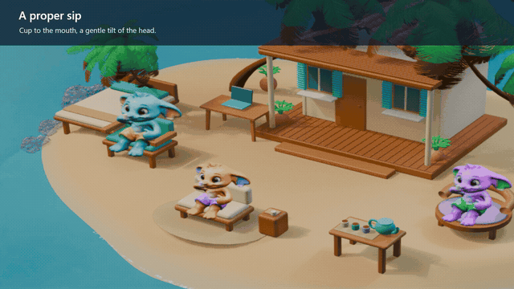

The product preview illustrates the scene and panels. Any staged media fixtures in the demo are labeled; a preview is separate from native playback and physical phone evidence. [V7 details and editable source](docs/WALLPAPER_V7.md).

### Native Windows panels

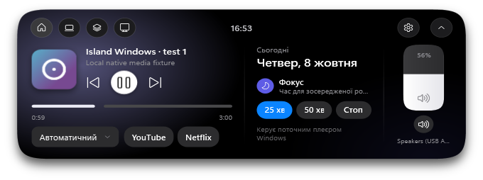

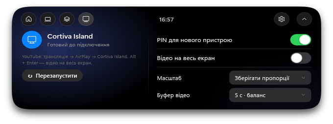

The panels above and the images in Downloads are rendered by the application itself, not screen captures. [Feature images](https://github.com/endrymagolas-wq/island-desktop/releases/download/windows-v0.4.0-beta.2/island-desktop-images.zip) · [raw panel screenshots](https://github.com/endrymagolas-wq/island-desktop/releases/download/windows-v0.4.0-beta.1/island-desktop-windows-screenshots.zip) · [the 41-second video](https://github.com/endrymagolas-wq/island-desktop/releases/download/windows-v0.4.0-beta.2/island-desktop.mp4) (1080p, music, no narration) · [the earlier silent demo](https://github.com/endrymagolas-wq/island-desktop/releases/download/windows-v0.4.0-beta.1/island-desktop-windows-demo.mp4).

## GNOME desktop

The Linux profile combines light GTK3/GTK4 themes, matching icons, Inter, traffic-light window controls, a floating Ubuntu Dock, a light wallpaper and Layerlight waves driven by system playback. The island supplies MPRIS controls, per-app audio, phone-volume feedback, focus tools and notification history. Custom-titlebar profiles depend on application compatibility.

The interface currently uses Ukrainian labels. Disable conflicting top-bar/autohide extensions before testing. Check `gnome-shell --version` and keep the installer's version validation enabled.

From this repository or the extracted source archive:

```bash
sudo apt install git python3 python3-venv gnome-shell-extensions

# Full appearance profile dependencies
sudo apt install python3-gi gir1.2-gtk-3.0 gnome-shell-extension-ubuntu-dock \
  pipewire-bin fontconfig qrencode

# Preview changes, then install
python3 install.py install --desktop --dry-run
python3 install.py install --desktop
```

For a smaller installation that keeps the rest of your desktop appearance:

```bash
python3 install.py install --dry-run
python3 install.py install
```

Save your work, log out and log back in to load the extension. The installer prints a recovery manifest; retain its path. Appearance assets are installed offline, replaced files are backed up and changed settings are recorded. `--no-activate` copies files without changing settings or starting services.

The separate GNOME cartoon wallpaper uses one worker and its own cached-frame player. Install with `python3 install_wallpaper.py`; see [setup](docs/CLAUDE.md). Windows V7 has a different runtime and is not advertised as a native GNOME V7 port.

Optional Linux receivers, browser players and Netflix phone remote are documented in the [desktop guide](docs/DESKTOP.md). Linux audio uses Shairport Sync; supported video uses a separately built, patched UxPlay. The Linux installer does not alter firewall/router policies.

### Optional offline Laya

Laya monitors supported resource, task, download, connectivity and service events and offers short recommendations. It starts **OFF** on a fresh installation. It does not delete files, close other applications or execute model-selected commands.

```bash
python3 setup_assistant.py
export PATH="$HOME/.local/bin:$PATH"
island-assistant on
island-assistant status
island-assistant off
```

Setup needs internet to download pinned Python dependencies and the model; inference then runs offline. The model weights are about 644 MB. Allow several GB of disk for dependencies and around 2 GB RAM for the loaded model. Python 3.10+ is required; actual inference was checked with Python 3.11. Economic mode releases the owned model after 60 seconds idle. Notices are limited to three per five minutes. `island-assistant diagnose` works with the assistant OFF.

Monitoring reads system metrics, coarse same-user process/service information and top-level download names/size/mtime. It does not read download contents, keystrokes, browser history, command lines or environment variables. Preferences and recent notices remain under `~/.local/share/island-desktop/assistant/`; redact local process/service names before publishing logs. See [Linux validation](docs/VALIDATION.md).

## Restore and privacy

On Windows, use the package's stop action and switch off any startup preference before removing its folder. The island restores the previous taskbar state on exit; its launcher also handles island crashes. The full bundle's stop action closes its own wallpaper entry and restores the captured previous Lively layout; standalone wallpaper has a restore action. Pairing keys and preferences stay in local user data.

Restore a GNOME installation using the manifest printed by its installer:

```bash
python3 install.py restore /absolute/path/to/manifest.json
```

Restore reinstates original files and unchanged settings, retains later preferences and stops before overwriting manually edited installed source. Save work and log out/back in afterward.

Optional Windows audio response and Linux Layerlight analyze system playback, not microphone input, and do not save raw audio. Windows does not install GNOME themes, Linux Laya or the Netflix phone remote. Local suppression of Seelen flyouts on the development PC is not a portable feature that disables every Windows popup.

Physical sleep/resume/lock, exclusive fullscreen, broad monitor/scaling combinations and every third-party player remain separate beta checks. [Release evidence and limitations](docs/RELEASE_VALIDATION.md) distinguish automated checks, browser previews, native operation and physical phone verification.

## Source and licenses

Project code is **GPL-3.0-or-later**. Third-party runtime, theme, font and artwork licenses are preserved: [general notices](THIRD_PARTY_NOTICES.md), [Windows notices](windows/THIRD_PARTY_NOTICES.md), [asset provenance](art/ASSET_SOURCES.md).

Development commands and build dependencies: [Windows](windows/README.md), [GNOME desktop](docs/DESKTOP.md), [Linux validation](docs/VALIDATION.md). This is an unofficial project with no affiliation to Apple, Microsoft, GNOME, Ubuntu or the Laya authors.
